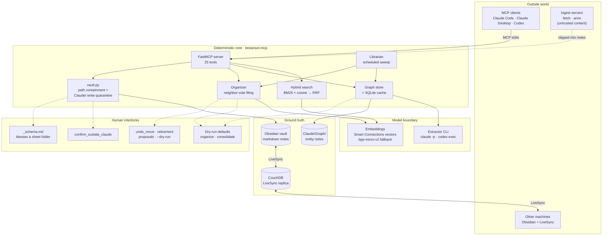
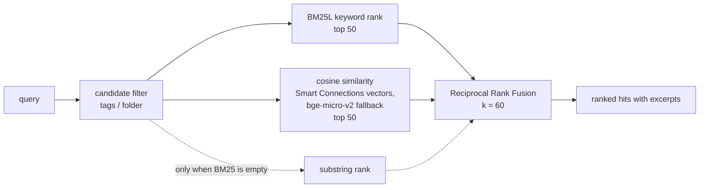
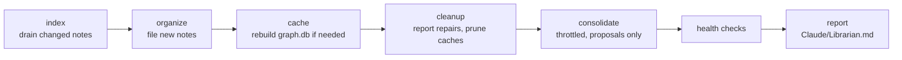

<div align="center">

# Tesseract

**Persistent, shared memory for AI agents, living in a plain-markdown Obsidian vault.**

[](https://github.com/DeepExtrema/tesseract-mcp/actions/workflows/ci.yml)
[](pyproject.toml)
[](https://modelcontextprotocol.io)
[](https://obsidian.md)
[](#tool-reference)
[](evals/README.md)


</div>

Every agent session, on any machine, reads from and writes to the same
knowledge base. `tesseract-mcp` is the MCP server that lets agents search it,
extend it, and keep it organized, while the vault's markdown stays the single
source of truth.

- **Hybrid retrieval.** BM25 and embedding similarity fused with Reciprocal Rank Fusion.
- **A knowledge graph you can open.** Entities extracted by an LLM are written as real markdown notes under `Claude/Graph/`.
- **A write contract enforced in code.** Agents write freely under `Claude/`; everything else needs explicit confirmation.
- **Self-maintaining.** One scheduled Librarian sweep indexes, files and reports what needs repair.
- **Rebuildable state.** Every cache lives under `~/.tesseract-mcp/` and can be deleted and rebuilt from the vault.

## Contents

[Architecture](#architecture) · [Features](#features) · [Quickstart](#quickstart) ·
[Client configuration](#mcp-client-configuration) · [Tool reference](#tool-reference) ·
[Configuration](#configuration) · [Operator CLIs](#operator-clis) ·
[Retrieval quality](#retrieval-quality) · [Contributing](#contributing) · [License](#license)

## Architecture

The system is drawn on five trust bands. Arrows point from the caller to what
it depends on.



Markdown is authoritative. The search index is rebuilt per query, and the
embedding cache and `graph.db` mirror live in a per-vault state directory, so
only the vault itself ever travels through LiveSync. Full detail:
[docs/ARCHITECTURE.md](docs/ARCHITECTURE.md).

### Retrieval pipeline



Fusion works on rank position, so BM25 scores and cosine similarities never
need normalizing against each other. The substring ranker only fires for
queries the tokenizer can't match, such as single characters or punctuation.

### The Librarian sweep



Each step is isolated: a failure records an error and later steps still run.
The CLI exits non-zero when any step failed, so a scheduler can alert on it.

## Features

| Area | What it does |
|---|---|
| **Hybrid search** | BM25L and embedding cosine similarity over the same candidate set, fused with RRF (k = 60). Reuses Obsidian Smart Connections vectors when fresh; falls back to the same model (bge-micro-v2) locally so the vector space is never mixed. |
| **Semantic graph** | An LLM pass extracts people, organizations, domains, topics, projects and sources into entity notes under `Claude/Graph/`, mirrored into SQLite for traversal. `related_notes` ranks connections by strength (each shared entity adds 1/hop, so direct and multiple links win), caps the list (default 20), and explains each one with its entity chain. |
| **Write contract** | `vault.py` contains every path to the vault and quarantines writes to `Claude/`. Writing elsewhere requires `confirm_outside_claude=True`. The human-readable rules ship as a constitution note. |
| **Structured sheets** | A human folder becomes agent-writable only when it holds a `_schema.md`. `sheet_upsert` validates every field against that schema. |
| **Organizer** | Files new notes by embedding neighbor vote. A share of ≥ 0.7 moves the note; below that, an unfiled note becomes a proposal for a human and an already-filed note stays put. Every move is journaled and reversible with `undo_move`. |
| **Graph cleanup** | Finds mentions of deleted notes, dangling relations and merge-stub chains, and prunes derived caches. The sweep reports the repairs; `cleanup --apply-repairs` applies them (or opt in with `--auto-cleanup`). Retraction holds when so many notes are missing that the vault looks only partly present. The Librarian only proposes entity retirements; `cleanup --apply-retirements` applies them. |
| **Consolidation** | Finds duplicate entities with an LLM pass. Dry-run by default; the Librarian only ever proposes merges. |
| **Recall harness** | Claude Code skills that turn the vault into memory you can question. See [Skills](#skills). |
| **Provisioning** | One command installs a pinned set of 14 Obsidian plugins, seeds settings, and installs the `Claude/` conventions tree. Every plugin asset is checked against a reviewed SHA-256 lock before anything is written ([bumping a pin](docs/PLUGIN_LOCK.md)). `--check` reports drift. |
| **Session hooks** | A SessionStart hook injects project recall into new Claude Code sessions; a Stop hook nudges `log_session` after significant work. Both fail silent. |

### Skills

Installed with `python -m tesseract_mcp.skill_sync` from [`skills/`](skills/).

| Skill | Purpose |
|---|---|
| `/recall` | Researched answer from the vault, every claim cited as a `[[wikilink]]`; filed into `Claude/Answers/` |
| `/resume` | Briefing on where a project left off |
| `/digest` | Review of what changed: notes, captures, tasks, health |
| `/connections` | Graph serendipity: what links to a topic |
| `/clip` | Compile one external source into a cited Inbox note |
| `/distill` | Promote repeated captures into evergreen concepts |
| `/decide` | Record a decision in the append-only ledger |
| `/rounds` | Read-only health inspection of the caretakers |
| `/dossier` | Deep multi-section briefing on a topic |

## Quickstart

Requirements: Python 3.11+, an Obsidian vault, and the `claude` or `codex`
CLI on `PATH` for entity extraction. Windows commands come first; the
[macOS / Linux](#macos--linux) steps follow.

```powershell
git clone https://github.com/DeepExtrema/tesseract-mcp
cd tesseract-mcp
python -m venv .venv
.venv\Scripts\pip install -e .
```

Provision a vault (plugins, settings, conventions tree). It is idempotent:
settings and conventions files are only written where none exist, and a
plugin is only (re)installed when its version differs from the pin.

```powershell
.venv\Scripts\python -m tesseract_mcp.provision <path-to-vault>
```

Register the curated MCP server set (tesseract plus fetch and arxiv ingest)
into Claude Code. Sync is additive: existing entries are never changed.

```powershell
$env:TESSERACT_VAULT_PATH = "<path-to-vault>"
.venv\Scripts\python -m tesseract_mcp.mcp_sync --check   # preview
.venv\Scripts\python -m tesseract_mcp.mcp_sync           # apply
```

Then open the vault once in Obsidian (disable Restricted Mode, finish LiveSync
setup) and call the `index_brain` tool to build the graph.

### macOS / Linux

Same flow with the POSIX venv layout (`.venv/bin/`):

```bash
git clone https://github.com/DeepExtrema/tesseract-mcp
cd tesseract-mcp
python3 -m venv .venv
.venv/bin/pip install -e .
.venv/bin/python -m tesseract_mcp.provision <path-to-vault>
export TESSERACT_VAULT_PATH="<path-to-vault>"
.venv/bin/python -m tesseract_mcp.mcp_sync --check   # preview
.venv/bin/python -m tesseract_mcp.mcp_sync           # apply
```

`mcp_sync` and `hook_sync` pick the right venv binary on every OS. Set
`TESSERACT_VAULT_PATH` wherever the hooks run too: their built-in default
is the Windows path `C:\Vaults\Tesseract`. If the vault is already synced
another way (iCloud Drive, for example), skip LiveSync rather than running two
syncs on one vault.

## MCP client configuration

The server is a stdio process started by the `tesseract-mcp` console script.
It needs one environment variable, `TESSERACT_VAULT_PATH`.

**Claude Code**: `mcp_sync` does this for you; the manual equivalent is:

```powershell
claude mcp add --scope user tesseract -e TESSERACT_VAULT_PATH=C:\Vaults\Tesseract -- C:\path\to\tesseract-mcp\.venv\Scripts\tesseract-mcp.exe
```

**Claude Desktop**: add to `claude_desktop_config.json`:

```json
{
  "mcpServers": {
    "tesseract": {
      "command": "C:\\path\\to\\tesseract-mcp\\.venv\\Scripts\\tesseract-mcp.exe",
      "env": { "TESSERACT_VAULT_PATH": "C:\\Vaults\\Tesseract" }
    }
  }
}
```

On macOS and Linux the command is `<repo>/.venv/bin/tesseract-mcp`. Any MCP
client that can launch a stdio server works the same way. In a new
session, call `onboard` first.

## Tool reference

25 tools, grouped by what they touch. Write tools stay inside `Claude/`
unless a call explicitly confirms otherwise.

| Group | Tool | Purpose |
|---|---|---|
| **Orient** | `onboard` | Call first: constitution, routing, cheat-sheet, graph status |
| **Retrieve** | `search_brain` | Hybrid search with optional tag/folder filters |
| | `context_bundle` | Search hits plus their graph entities and related notes in one call; the related list is capped at 20 |
| | `recall_bundle` | Read-only raw material for `/digest` (`mode="digest"`) and `/resume` (`mode="resume"`) |
| | `read_note` | Read any note |
| | `query_notes` | Filter notes by frontmatter metadata |
| | `get_backlinks` | Notes whose `[[wikilinks]]` point at a note |
| | `list_recent` | Recently modified notes |
| | `list_tasks` | Checkbox tasks across the vault |
| **Write** | `log_session` | Session note in `Claude/Sessions/` |
| | `capture` | Timestamped thought in today's `Claude/Inbox/` note |
| | `upsert_concept` | Create or extend an evergreen note in `Claude/Concepts/` |
| | `write_note` | General write; outside `Claude/` only with `confirm_outside_claude=True` |
| | `add_task` | Obsidian Tasks checkbox in `Claude/Tasks.md` |
| **Sheets** | `sheet_upsert` | Schema-validated create/update of one row in a registered sheet |
| | `sheet_query` | Typed filter/sort over a sheet's rows |
| | `sheet_schema` | List sheets, or show one sheet's full contract |
| **Graph** | `index_brain` | Extract entities from new/changed notes; call again while `remaining > 0` |
| | `find_entity` | Look up entities by name or alias, optional type filter |
| | `related_notes` | Notes connected through shared entities, ranked by strength and capped by `limit` (default 20), with the chain |
| | `graph_stats` | Entity, edge and mention counts |
| | `consolidate_graph` | Merge duplicate entities (dry-run by default) |
| **Organize** | `organize_vault` | Neighbor-vote filing sweep (dry-run by default) |
| | `librarian_status` | Last sweep's results, health checks and pending proposals (read-only) |
| | `undo_move` | Reverse the organizer's most recent move of a note |

## Configuration

| Variable | Default | Purpose |
|---|---|---|
| `TESSERACT_VAULT_PATH` | required | Vault root the server opens |
| `TESSERACT_STATE_DIR` | `~/.tesseract-mcp/<vault-hash>/` | Where caches and Librarian state live |
| `TESSERACT_EXTRACTOR` | `codex` | Extraction backend: `codex` or `claude` |
| `TESSERACT_EXTRACT_MODEL` | `haiku` | Per-note extraction model (`claude` backend only) |
| `TESSERACT_CONSOLIDATE_MODEL` | `sonnet` | Consolidation model (`claude` backend only) |
| `CLAUDE_SETTINGS_PATH` | `~/.claude/settings.json` | Settings file `hook_sync` writes hooks into |
| `TESSERACT_OWNER` | `the vault owner` | Owner name written into new vault-root `AGENTS.md` and `CLAUDE.md`; existing guides are never rewritten |

`mcp-servers.json` is the curated server manifest and
`vault-template/plugins.json` pins the Obsidian plugin versions.

## Operator CLIs

These run outside the MCP server and are never exposed as tools.

| Command | What it does |
|---|---|
| `python -m tesseract_mcp.librarian <vault> [--dry-run]` | The scheduled caretaker sweep |
| `python -m tesseract_mcp.indexer <vault> [--rebuild-only]` | Index directly, or rebuild `graph.db` from the markdown |
| `python -m tesseract_mcp.organize <vault> [--dry-run]` | Run only the filing sweep |
| `python -m tesseract_mcp.cleanup <vault> [--apply-repairs [--force]] [--apply-retirements]` | Report deleted notes and orphaned entities; apply the mechanical repairs or retire the orphans on request |
| `python -m tesseract_mcp.consolidate <vault> [--apply]` | Propose duplicate-entity merges; apply them on request |
| `python -m tesseract_mcp.sheets <vault> --check` | Validate every sheet row against its schema |
| `python -m tesseract_mcp.provision <vault> [--check]` | Provision or check a vault |
| `python -m tesseract_mcp.mcp_sync [--check]` | Register the MCP server set in Claude Code |
| `python -m tesseract_mcp.skill_sync [--check]` | Install the skills into `~/.claude/skills` |
| `python -m tesseract_mcp.hook_sync [--check \| --install]` | Install the SessionStart and Stop hooks |
| `python -m tesseract_mcp.evals` | Run the retrieval benchmark |

### Scheduled maintenance

> **First Librarian run on a real vault: use `--dry-run`** and review the
> report before scheduling unattended runs. Dry-run writes no state, moves,
> report, throttle baselines or vector caches. It still calls the
> consolidation model so the report can show merge proposals. The CLI
> enforces this: on a vault with no prior sweep, an applying run refuses
> until you pass `--confirm-first-run` once by hand. `scripts/librarian-task.cmd` is the Windows
> Task Scheduler entry point.

On macOS, schedule with launchd instead. Each template says how to install
and remove it. Install one of the two, not both (if both fire, a caretaker
lock in the state dir makes the second one refuse rather than write at the
same time):

| Template | Runs |
|---|---|
| `scripts/com.tesseract.librarian.plist.template` | The full Librarian sweep daily at 04:00 (includes indexing) |
| `scripts/com.tesseract.index.plist.template` | `scripts/index-nightly.sh` at 04:30: incremental indexing only, no file moves |

> **macOS privacy:** a launchd job can't read a vault in iCloud Drive
> (`~/Library/Mobile Documents/`) or another protected folder unless the
> program launchd starts (`/bin/bash`, or the venv `python`) has Full Disk
> Access in System Settings > Privacy & Security. Without it,
> `index-nightly.sh` exits with `cannot read vault`. Grant it deliberately,
> or keep the vault outside protected folders.

### Trust boundaries

- The `Claude/` write quarantine is enforced by the MCP server's write tools.
  The operator CLIs above also write elsewhere (`.obsidian/plugins`,
  vault-root `AGENTS.md` and `CLAUDE.md`, organizer moves), so review them
  before pointing them at a vault you care about.
- Content arriving through `fetch` and `arxiv` is untrusted. It lands in
  notes, and the extractor reads full note text, so treat anything recalled
  from ingested sources as data, not instructions.

## Retrieval quality

Latest recorded baseline (2026-07-11), from 17 golden queries run against the
production `hybrid_search` path with real bge-micro-v2 embeddings over the
synthetic fixture corpus in [`evals/`](evals/README.md):

| success@5 | success@10 | recall@5 | recall@10 | MRR |
|---|---|---|---|---|
| 0.94 | 1.00 | 0.94 | 1.00 | 0.86 |

The corpus is synthetic because this repo is public; a private golden set
lives in the vault. Reproduce with `python -m tesseract_mcp.evals`.

## Repository layout

```text
src/tesseract_mcp/   server, retrieval, graph, organizer, librarian, CLIs
skills/              Claude Code skills (/recall, /resume, /digest, ...)
scripts/hooks/       SessionStart and Stop hooks
vault/               constitution and root guide installed into vaults
vault-template/      pinned Obsidian plugins and settings
evals/               synthetic fixture vault and golden queries
server/              CouchDB + Caddy stack for LiveSync
docs/                architecture, design specs and plans
tests/               pytest suite
```

## Contributing

```powershell
.venv\Scripts\pip install -e ".[dev]"
.venv\Scripts\python -m pytest -q
```

- Base branch is `codex/architecture-roadmap`. Open PRs against it; CI runs the full suite on every PR ([`ci.yml`](.github/workflows/ci.yml)).
- Keep markdown authoritative: anything the server derives must be rebuildable from the vault.
- Never import numpy, torch or sentence-transformers lazily inside a tool body. Warm them at startup (`server._warm_start()`); see the appendix in [ARCHITECTURE.md](docs/ARCHITECTURE.md). Verify with `python scripts/probe_server.py`.
- Eval thresholds live in `tests/test_evals.py`. If the baseline drops below a floor, fix the fixture or golden set; never lower the floor.
- Agents: run sync tools with `--check` and against throwaway vaults only; live syncs need the owner's consent (see [AGENTS.md](AGENTS.md)).

### Opt-in hardening

Off by default in the code. The scheduled entry points turn tool-less
extraction on, because unattended sweeps read clipped web content.

| Knob | Effect |
|---|---|
| `librarian --auto-cleanup` or `TESSERACT_AUTO_CLEANUP=1` | The sweep applies the mechanical graph repairs itself instead of reporting them |
| `librarian --max-moves N` | Caps organizer moves per sweep; confident moves past the cap are skipped and re-evaluated next sweep (`0` = file nothing) |
| `TESSERACT_READONLY=1` | MCP server registers only read tools; `log_session`, `capture`, `upsert_concept`, `write_note`, `add_task`, `sheet_upsert`, `index_brain`, `consolidate_graph`, `organize_vault`, `undo_move` are absent |
| `TESSERACT_NO_TOOL_APPLY=1` | Keeps the note-writing tools but refuses `organize_vault(apply=True)`, `consolidate_graph(apply=True)` and `index_brain(force=True)`, so only the scheduled sweep or a human at the CLI can move notes, merge entities or re-extract the whole vault |
| `TESSERACT_EXTRACTOR_NO_TOOLS=1` | Extractor CLI runs with no tools (`claude --tools "" --strict-mcp-config`, `codex exec --sandbox read-only`), so instructions inside note text cannot act during extraction. The shipped schedules (`librarian-task.cmd`, both launchd templates via `index-nightly.sh` or the plist) set it; MCP `index_brain` calls still follow your environment |

## Going deeper

- [Architecture deep dive](docs/ARCHITECTURE.md): retrieval, graph, write contract, organizer, Librarian, module map
- [Server deployment](server/DEPLOY.md): CouchDB + Caddy for LiveSync
- [Evals](evals/README.md): query schema and baseline history

## License

No license file has been added yet, so all rights are reserved by default.
